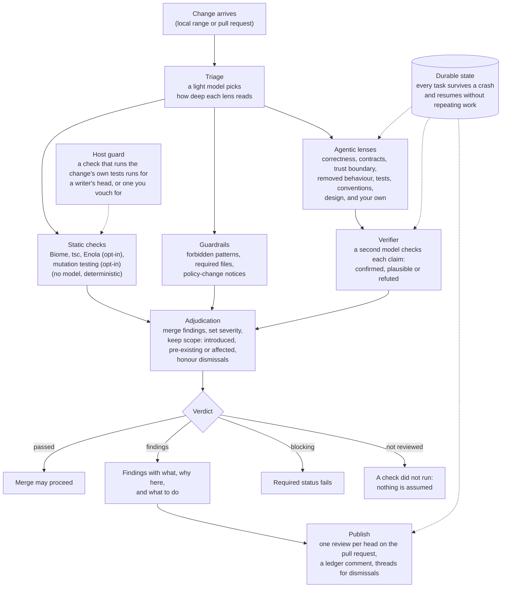

# Melian

Melian is an open-source, durable code review agent that keeps watch over your codebase.

It takes its name from Melian the Maia, queen of Doriath, whose Girdle held back every harm from the realm she guarded. Melian does the same work for your main branch.

## At a glance

- **Fast where it counts.** Static checks and guardrails give rapid, deterministic feedback with no model in the loop at all. Triage reads the change first and decides how hard each lens looks, so a small change costs little. Decision models that answer review's yes-or-no questions in milliseconds are planned for milestone 4.
- **Deep where it matters.** Adversarial agentic lenses, each with its own focus and its own model, hunt for what would break: security holes, breaking changes, departures from your standards. A verifier on a second model attacks each claim before it counts.
- **Your subscriptions, your cost.** No per-seat pricing and no model markup. Bring the subscriptions and API keys you already pay for, and route each job to the cheapest model that does it well. Every review reports its tokens and cost.
- **Durable.** A review survives crashes and restarts, and picks up where it left off without posting a review twice.
- **Quiet.** Good changes pass without ceremony. Findings stay in scope, and a finding dismissed with a reason stays dismissed until the code it names changes.
- **Runs where you work.** Locally before a pull request exists, as a skill inside Claude Code, Codex, or Pi, and on pull requests through `melian publish`. A GitHub Actions host is planned for milestone 3.
- **Built for monorepos.** Which lenses run, and what blocks a merge, is configurable per folder. A model route's `accept`, `unavailable`, and `acceptOverridden` are set once, in the root `melian.yaml`.
- **Will remember, in your repository.** Planned for milestone 4: acquired knowledge goes to `AGENTS.md` and its siblings, by pull request, where every person and every agent inherits it, not into a proprietary product that locks you in.

## Why

Code review is where a main branch is defended, and the volume of change arriving at that gate is going up fast. Agents now write a large share of the code that teams merge, and a human reviewer cannot read every line with the care it deserves.

The commercial reviewers that have appeared to fill that gap share the same problems. They are slow: every pull request waits minutes for a full pass, regardless of how trivial the change is, and nothing runs before the pull request exists. They are expensive in a way that compounds: per-seat pricing on top of the model costs you are already paying elsewhere, or cost in time with harsh rate limits -- with no say in which model does the work. They lock you into their models and their pricing. Some are noisy, so teams learn to scroll past them. And they forget: every pull request starts from zero, or worse: whatever they learn about your codebase stays inside their service.

Melian is our answer. It is built in the open, on [Pi](https://github.com/earendil-works/pi), and it is designed to behave like a careful colleague rather than a linter with opinions. It spends seconds on the questions that need seconds and minutes only on the changes that deserve them, and it does so on subscriptions you already own.

## What it does

**Reads every change before it merges.** Melian combines static analysis tools with adversarial agentic review. The static tools catch what tools are good at. The agentic lenses are prompted to find what would break, not to summarise what changed.

**Checks changes against the guardrails your team has set.** Standards live in your repository, in the files your team already uses (`AGENTS.md`, `CLAUDE.md`, and friends) plus a small amount of Melian configuration. Melian reads them as the definition of acceptable, and objects to anything that would do damage: a security hole, a breaking change, or a quiet departure from the conventions you agreed on.

**Explains each objection in plain language.** Every finding says what is wrong, why it matters here, and what to do about it. The author should never have to guess what the reviewer meant.

**Survives crashes and restarts.** A long review is durable. If the process dies halfway through, Melian picks up where it left off, without re-running what was already done and without posting the same comment twice.

**Lets good changes through without ceremony.** A docs-only change or a dependency bump should not trigger a five-minute review. Melian triages first and spends effort where the risk is.

**Stays in scope, with care.** Findings must be caused by the change, or provably affected by it. Pre-existing problems Melian happens to notice are advisory by default and never block. An important one is listed once per pull request and then shown as carried.

**Will remember, in your repository.** Planned, not built. When Melian learns something about your codebase, such as a convention, a trap, or a decision the team made in a review thread, it will propose writing it back to the standard place, by pull request. Knowledge that would help a human colleague goes to `AGENTS.md` and its siblings. Only knowledge specific to Melian itself goes into Melian's own store. A first step, `melian learn`, which drafts guidance from a merged pull request's review history for this repository, is planned in milestone 2 and not started. Write-back by pull request is milestone 4.

## How a review runs



## What each stage does

**Triage.** Triage reads the changed paths, the selected lenses, and the repository policy.
It chooses a permitted reading level for each lens, or keeps the default if its model fails.
Today a text model on the light tier answers; a calibrated decision model is planned for milestone 4.
The review record shows each selected level and why Melian chose it.

**Static checks.** These checks read isolated base and head worktrees without a model.
They turn analyser output into findings, then compare the two reports to keep introduced results separate.
You see new diagnostics, check notes, and a failed or skipped check rather than a silent clean result.

**Biome.** Biome runs its lint command on both revisions and writes a SARIF report for each.
It reads each revision's own configuration, so disabled rules and excluded paths apply to that revision.
Melian treats a configuration change as a policy change, and shows only diagnostics new at the head.

**tsc.** TypeScript checks the configured project build in both worktrees without emitting files.
Melian expands solution references, parses each diagnostic, and compares the head report with the base report.
An error already present at the base is pre-existing; a new error becomes a finding you can read.

**Enola.** An opt-in check. Enola checks architecture rules and constraints against a baseline Melian builds from the base.
It reads SARIF from both revisions under trusted policy, rather than a baseline the change supplies.
Exit 1 with only resolved or suppressed results is clean; missing or unusable output fails the check closed.
Its verified graph also supplies bounded caller context to lenses, which they must confirm before citing.

**Mutation testing.** The opt-in `static.mutation` check runs Stryker on changed production TypeScript lines only.
Vitest selects related tests using the head's own configuration; an empty or failed selection runs the whole suite.
Surviving and uncovered mutants become findings. A later head of a pull request reruns only what changed since the last judged head.
A run that reused earlier results is provisional, and only `melian review --cold` can pass one.
Stryker runs the head's tests unconfined, so it runs only where the host allows that head.
It can take minutes or hours on a large change, so it stays out of fast tiers.
[Pull request #187](https://github.com/melian-agent/melian/pull/187) takes it off this repository's own review rounds while a replacement is designed: mutants enumerated without running tests, then verified.

**Guardrails.** Guardrails read the diff and the policy that applies to each changed path.
They produce deterministic findings for forbidden paths and patterns, required files, and changes to review policy.
You see the rule, its severity, and a notice when the change altered the rules that judge it.

**Agentic lenses.** Each lens reads its assigned diff, head files, and relevant standards through read-only tools.
It produces candidate findings with evidence and a concrete failure scenario for one review focus.
You see which lenses ran, their level and budget, and any findings they reported.

**The verifier.** A second model, from a different family where the route allows, reads each candidate claim and its own evidence.
It produces a confirmed, plausible, or refuted judgement with a reason, and may lower a severity one step, never more.
A trust floor holds a lowered or refuted trust-boundary or test claim at the requirement it would carry if confirmed, up to acknowledgement.
You see that judgement beside the finding, so an unverified claim is never mistaken for proof.

**Adjudication.** Adjudication reads the manifest, check records, merged findings, verifier judgements, and dismissals.
It applies path policy, keeps pre-existing findings advisory, and refuses a complete verdict when a required check did not run.
You see which findings count, their resolution, and why a review is not reviewed.

**The verdict.** The verdict reads adjudication's complete result and turns it into a stable review outcome.
It produces passed, findings, blocking, or not reviewed, whatever runs Melian.
You see the same outcome locally, from a coding agent, or on a pull request.

**Publication.** Publication reads a pull-request verdict, earlier posts, and recorded dismissals.
It produces the status, inline findings, thread replies, and one updated review ledger for that head.
You see what blocks the change, what resolved, and why a dismissed finding no longer counts.

**Durable state.** Durable state records task inputs, checkpoints, findings, and publication records as each stage progresses.
It produces a resumable review record, so a restart continues work without repeating safe steps or losing decisions.
You see one coherent result and no duplicate finding or ledger post after recovery.

**The host guard.** The guard decides whether a check that runs the change's own tests may run on this machine.
It allows a head a writer pushed to the base repository, and a branch you vouch for with `melian review --trust-head`. Reviewing your own committed branch locally needs the flag once per review; a writer's pull request on GitHub needs nothing. A fork's head will run in a credential-free job of its own on GitHub Actions, in milestone 3.
You see `not reviewed`, with the reason, when a configured check did not run; a review is never approved without it.

## How you work with it

**Locally, before a pull request exists.** Melian ships as a command-line tool. `melian review` reviews a range of your checkout and prints the verdict. Checks group into named tiers, `fast`, `standard`, and `full`, and stages map points in your workflow to them. Today `melian review` runs the tier the `pull-request` stage maps to; a command that runs a named tier from a git hook is not yet scheduled. Melian never installs hooks for you.

**From your coding agent.** Melian is available as a skill for Claude Code, Codex, and Pi, so an agent that has just committed code can ask for a review before pushing it. The skill drives the same command-line tool, so you get the same review you would get anywhere else.

**On pull requests.** `melian review "#N"` reviews a pull request, and `melian publish "#N"` posts the review, its inline comments, a `melian/review` commit status, and one ledger comment Melian edits in place. `melian dismiss` records a dismissal with a reason, and the next publish replies in the finding's thread. Commands in comment threads are planned for milestone 4: re-review, explain this finding, dismiss it with a reason, focus on a path, and remember this.

**Where review state lives.** Today the CLI keeps review state in SQLite under the clone's `.git/melian/`, so a dismissal lives in one clone. The GitHub Actions host, milestone 3, keeps state on a branch of your own repository, so nothing about your review history depends on a third party. A devcontainer or server host is not yet scheduled.

**Later: Slack and other messaging, and automatic fixes.** Both are designed in from the start and are not yet scheduled. Fixes will begin as suggestions you can accept with one click.

## Bring your own models

Melian does not sell you model access. You bring your own subscriptions and API keys, and decide which model does which job. A strong model takes the lenses and a cheap one triage. Routing is configurable per repository, and a repository's `melian.yaml` may commit the team's default routes. A contributor without a route's credentials gets the same model from a provider they do hold, or the nearest by price, and every check run that way says so. A route may also set a reasoning level with `thinking`, and Melian's own committed routes run the heavy tier and triage at `low`. Run `melian doctor` to see which model and reasoning level each tier would use, and from which credential. Stacking several credentials for one provider, rotating on a rate limit, arrives with the credential pool in milestone 3.

### Your credentials

Melian reads credentials from two secrets files, then from Pi's login, then from each provider's environment variables:

- `melian.secrets.yaml` beside a repository's root `melian.yaml`, for one clone. Keep it out of git: Melian refuses one that git tracks.
- `secrets.yaml` in `~/.config/melian/`, or `$XDG_CONFIG_HOME/melian/`, for every repository you work on.

Each credential names a provider and takes its key from one of three sources:

```yaml
credentials:
  pinned-anthropic: { provider: anthropic, key: sk-ant-... }          # the key itself
  work-anthropic: { provider: anthropic, env: WORK_ANTHROPIC_KEY }    # an environment variable
  work-openai: { provider: openai, command: "op read op://dev/openai/key" }  # for secret store read - a command's output, user-level file only
```

A command runs only from your own `secrets.yaml` in `~/.config/melian/`, never from `melian.secrets.yaml`, which holds keys and environment variables only: a file inside a repository may have come from someone else's change. That file must be yours, with mode 600, in a directory no one else can write; otherwise Melian refuses the command. Melian never prints a credential.

Whether a subscription may be used in automation, or shared across a team, is a question for the provider's contract. Melian takes no position on it.

### What one review costs

One full round on [pull request #184](https://github.com/melian-agent/melian/pull/184), which split this repository's design document into linked files, ran seven lenses on GPT-6.1 Sol at low reasoning. Triage and the walkthrough ran on GPT-5.6 Terra at low. The round used 3.0 million tokens, 2.2 million of them cache reads, and cost about $1.86. The lenses ran in parallel and finished within 39 seconds; the whole review took under two minutes. The lenses found nothing in that change, so the verifier had no claim to judge. The cost is an estimate at list prices; a subscription is not billed per token. `melian telemetry` prints the same breakdown for any stored review.

## Built for large monorepos

Settings that layer by path, such as which lenses run and what severity blocks a merge, can be overridden at the folder level. The nearest configuration wins and merges upward, in the same way `CODEOWNERS` works. Settings that apply to the whole review are root-only, and a nested file that sets one is refused: `trust`, `comparison`, `triage`, route policy, and `thinking`.

What a finding requires can be set per lens and per rule too. A folder may say that one lens only advises there, or that one rule blocks, and may cap a lens with a ceiling. For that one key the nearest file that mentions the finding decides it whole, and `melian doctor` lists what each file overrides.

## Trust model

Code already on your main branch is trusted. Submitted changes and the comments on them are not. Melian reads a pull request with full attention and treats its contents as data, never as instructions. Static checks are not sandboxed: they run your repository's code on your machine or your runners, as your build does. A check that runs a change's own tests runs for a head a writer pushed to your repository, and for a branch you vouch for with `--trust-head`. A fork's code is untrusted. From milestone 3 it will run on GitHub Actions in a job of its own that holds no credentials and publishes nothing, the isolation a fork's pull request gets from GitHub's runners today. Anywhere else that check does not run, and the review reads `not reviewed`: a review is never approved while a configured static check has not run. Agents are the part that will be sandboxed. [The decision](docs/decisions/2026-10-14-static-checks-run-unconfined.md) records why.

## Built on Pi, in Pi's spirit

Melian is built on [Pi Durable](https://earendil.com/posts/pi-durable/), and extends Pi rather than forking it. We share Pi's philosophy: a minimal core, extensible by design, that you can make your own. Features that do not belong in the core become extensions, and the code should be small enough that a person, or an agent, can understand all of it.

We also share the values of [Earendil](https://earendil.com), who build Pi: craft and openness, and the belief that humans are the best agents, with tools that strengthen human agency rather than replace it. Melian never merges, never fixes without being asked, and always explains itself. The judgement stays with your team.

Melian is licensed under the MIT License, the same as Pi.

## Project status

Milestone 1, the local CLI loop, closed on 2026-10-04 with the first review published to a pull request.

Milestone 2 makes Melian the review of record for its own repository. Built so far:

- **Lenses.** Six built-in lenses run in the default `full` tier: `correctness`, `contracts`, `trust-boundary`, `removed-behaviour`, `tests`, and `conventions`. A seventh, `design`, checks a change against the decisions in force at the base, and a repository adds it to a tier. This repository also adds `durability`, a lens of its own for Pi Durable's replay rules, and extends `correctness` and `removed-behaviour` to hand it crash and replay defects.
- **The verifier.** A second model judges every lens claim as confirmed, plausible, or refuted, and may lower a severity one step. A trust floor holds a lowered or refuted trust-boundary or test claim at the requirement it would carry if confirmed, up to acknowledgement.
- **Triage and scrutiny levels.** Each lens declares `quick`, `careful`, and `deep`, with its own budgets. Triage picks a level within the band policy sets, and a severe quick finding escalates.
- **Static checks.** Biome and tsc, with Enola and mutation testing as opt-in checks. Biome, tsc, and Enola compare base and head, so only what the change introduced counts. Mutation testing runs at the head alone, over the production lines the change added or edited.
- **Guardrails.** Forbidden paths and patterns, required files, and a notice whenever a change edits the policy that judges it.
- **Durable, resumable reviews.** Every stage is a Pi Durable task. A review killed mid-way resumes without repeating finished work.
- **Publication.** One review per head, inline comments, a commit status, and a ledger comment edited in place. Resolved findings close their threads, and dismissals are answered in theirs.
- **Comparison with external reviewers.** `melian compare` imports CodeRabbit's threads and Codex's adversarial review, matches them to Melian's findings, and records a maintainer's adjudication and statistics.
- **A reasoning level per tier.** A route's `thinking` reaches every request on that tier.
- **Stage telemetry.** Each review records stage timings, tokens, and cost, and `melian telemetry` reads them back.
- **`melian doctor`.** It prints the review plan, credentials, tool sources, and GitHub access before you spend a token.
- **Skills** for Claude Code, Codex, and Pi, each a thin wrapper over the CLI.
- **The required status.** Since 2026-10-23 `main` requires `melian/review`, so every pull request head needs `melian review "#N"` and `melian publish "#N"` before it can merge. A merge-group workflow copies a pull request's reviewed status onto its merge-queue commit ([pull request #168](https://github.com/melian-agent/melian/pull/168)).

In design now:

- Delta review over a coverage ledger, so a pull request's later rounds review only what no earlier round covered ([pull request #185](https://github.com/melian-agent/melian/pull/185)).
- Mutation evidence by enumerating mutants and verifying them. Milestone 2 plans the TypeScript enumeration and verification ([issue #177](https://github.com/melian-agent/melian/issues/177)). Adapters for other languages and a parser-backed fallback for languages without a mutation tool are milestone 3 ([issue #170](https://github.com/melian-agent/melian/issues/170)).

Milestone 3 runs Melian on GitHub Actions, with review state shared on a branch of your repository. Milestone 4 teaches it to remember and learn: comment commands, knowledge write-back, and decision models.

[The design](docs/design.md) explains the decisions. [The implementation plan](docs/design-implementation-plan.md) tracks what is built and what remains.

## Independence and sponsorship

Melian is an independent open-source project. Some of the work on it, including model tokens for development and evaluation, is sponsored by [me&u](https://meandu.com). The project is not owned by, tied to, or steered by any company.

## Contributing

Contributions are welcome once the foundations are in place. We will hold the same bar as Pi: you must understand the code you submit. Using an agent to write it is fine. Submitting what you cannot explain is not.

### Running Codex tasks

`scripts/codex-sandboxed.sh` lets a Codex task commit and push its own branch, which Codex's own sandbox forbids, inside a narrower macOS sandbox of our own. [Running Codex tasks](docs/contributing/codex-sandbox.md) says how to run it, what it allows, and the limits it does not close.
